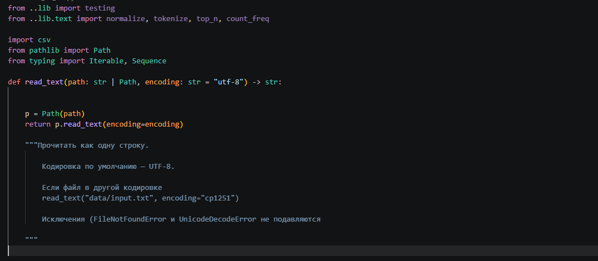
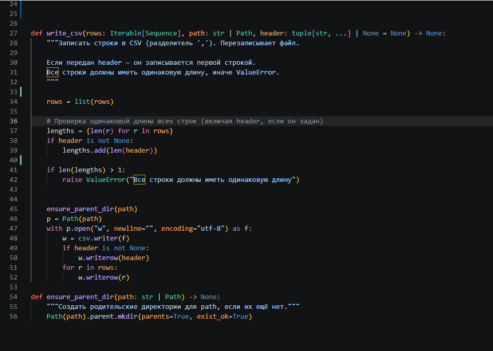
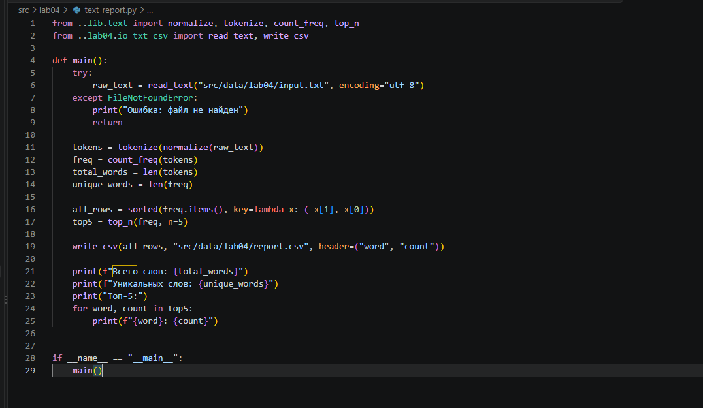
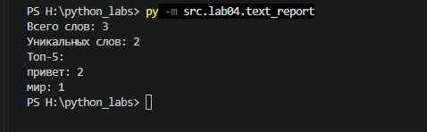
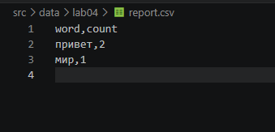
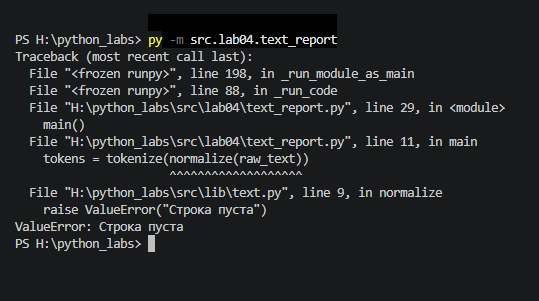
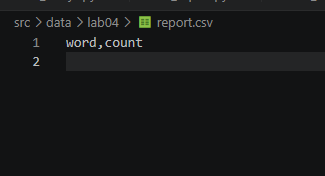
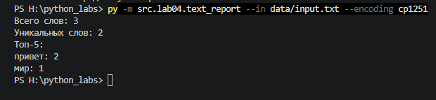
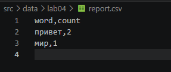

# Python Labs

## ЛР4 — Файлы: TXT/CSV и отчёты по текстовой статистике

### Запуск кода осуществляется из корня репозитория >> py -m src.lab04.text_report
---
## ЗАДАНИЕ A
### ФУНКЦИЯ READ_TEXT

### ФУНКЦИЯ WRITE CSV / ENSURE_PAR_DIR

## ЗАДАНИЕ B

### ФУНКЦИЯ MAIN

## ТЕСТ КЕЙСЫ

### "Привет, мир! Привет!!!"

### ВЫВОД

___

### Пустой файл

### ВЫВОД

___

### Кодировка cp1251 "Привет, мир! Привет!!!"

### ВЫВОД

