# Python Labs

## ЛР5 — JSON и конвертации (JSON↔CSV, CSV→XLSX): Техническое задание

### Запуск кода осуществляется из корня репозитория >> py -m src.lab05...
---

## Задание A — JSON ↔ CSV

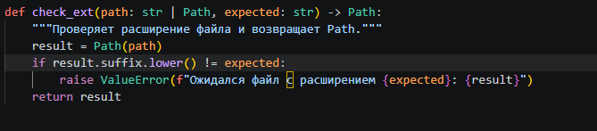
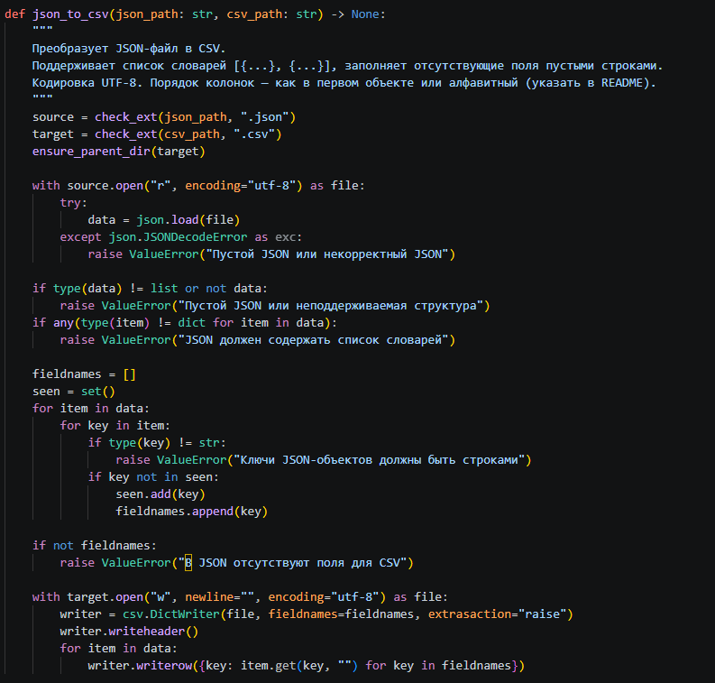
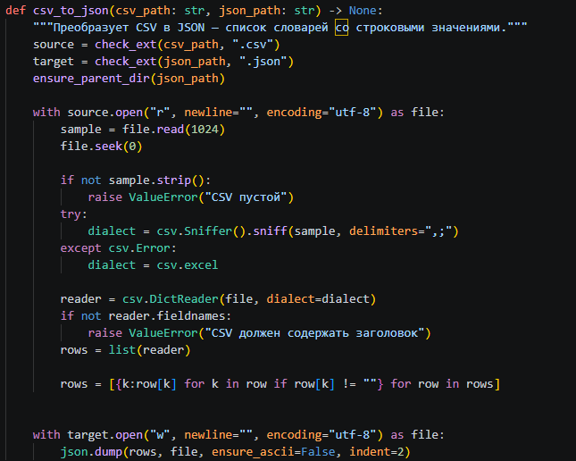

## ЗАДАНИЕ B — Задание B — CSV → XLSX

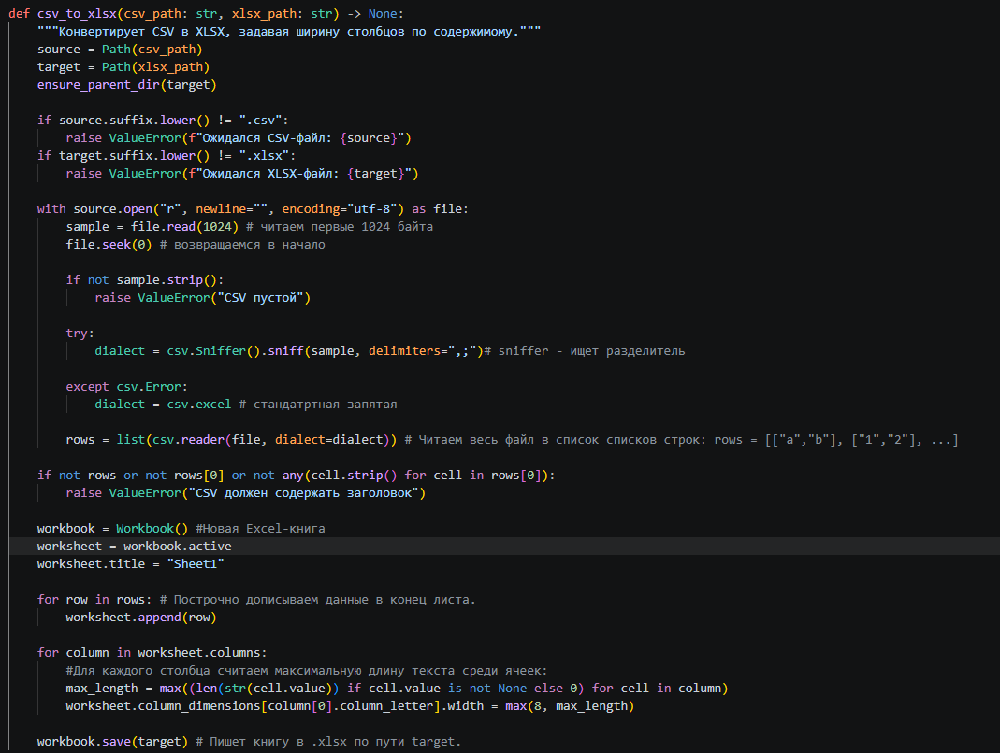
 
## ТЕСТ КЕЙСЫ

### ЗАПУСКИ
### json_csv.py

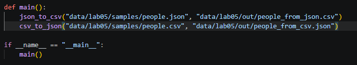

### csv_xlsx.py

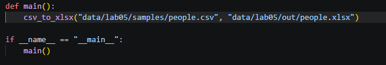

___

### ВЫВОД

### json -> csv

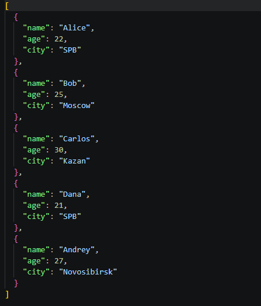
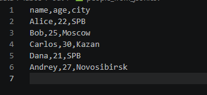
---
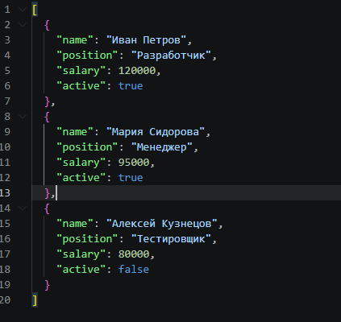
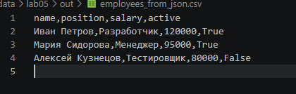

___
### csv -> json

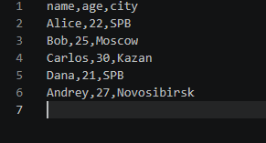
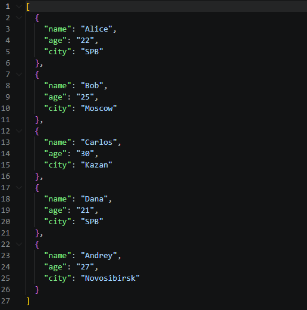
---
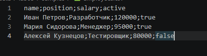
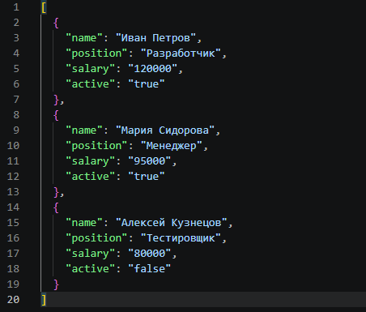

___
### csv -> xlsx

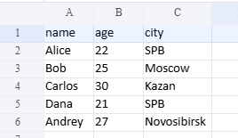
---

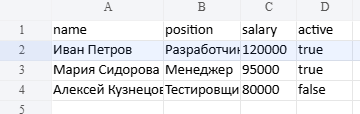