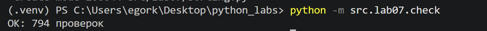
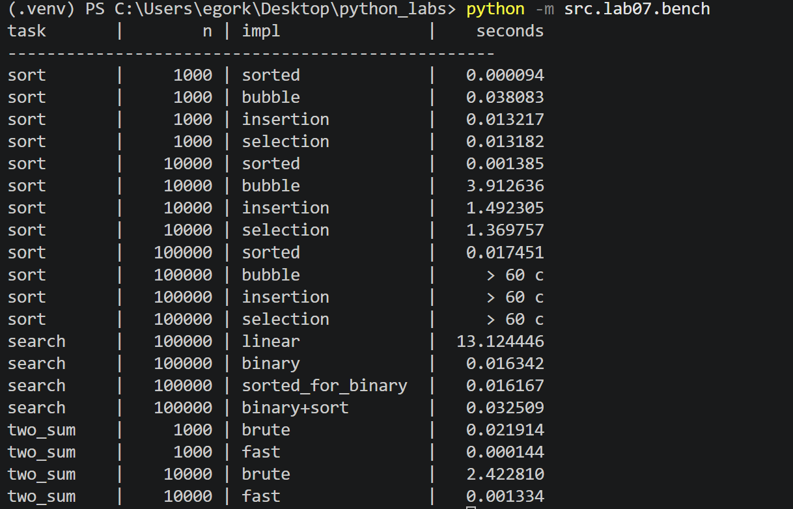

# ЛР7 - Поиск, сортировка и измерение времени
### Задание А

### `search.py`
```python
def linear_search(nums, x):
    """Индекс первого вхождения x или -1.

    linear_search([4, 2, 7, 2], 2) -> 1
    linear_search([4, 2, 7, 2], 9) -> -1
    linear_search([], 1) -> -1
    """
    for i in range(len(nums)):
        if nums[i] == x:
            return i
    return -1


def binary_search(sorted_nums, x):
    """Индекс x в отсортированном по возрастанию списке или -1.
    На неотсортированном списке результат не определён.

    binary_search([1, 3, 5, 7], 5) -> 2
    binary_search([1, 3, 5, 7], 4) -> -1
    binary_search([5], 5) -> 0
    binary_search([], 5) -> -1
    """
    lo = 0
    hi = len(sorted_nums) - 1
    while lo <= hi:
        mid = (lo + hi) // 2
        if sorted_nums[mid] == x:
            return mid
        elif sorted_nums[mid] < x:
            lo = mid + 1
        else:
            hi = mid - 1
    return -1


def two_sum_brute(nums, target):
    """Пара индексов (i, j), i < j, nums[i] + nums[j] == target, или None.

    two_sum_brute([2, 7, 11, 15], 9) -> (0, 1)
    two_sum_brute([1, 2], 10) -> None
    """
    for i in range(len(nums)):
        for j in range(i + 1, len(nums)):
            if nums[i] + nums[j] == target:
                return (i, j)
    return None


def two_sum_fast(nums, target):
    """То же, что two_sum_brute, но за один проход со словарём."""
    seen = {}  # значение -> индекс
    for j in range(len(nums)):
        need = target - nums[j]
        if need in seen:
            return (seen[need], j)
        seen[nums[j]] = j
    return None
```
1. **`linear_search`:** обычный проход по списку циклом `for`. При первом совпадении сразу возвращается индекс, если до конца ничего не нашли, возвращается `-1`.
2. **`binary_search`:** границы поиска хранятся в `lo` и `hi`. В цикле `while lo <= hi` берётся середина `mid`. Если элемент меньше искомого, поиск идёт в правой половине (`lo = mid + 1`), если больше, то в левой (`hi = mid - 1`). Когда `lo` стал больше `hi`, значения в списке нет и возвращается `-1`. Список должен быть уже отсортирован, на неотсортированном результат не определён (это указано в docstring).
3. **`two_sum_brute`:** два вложенных цикла перебирают все пары `(i, j)` с `i < j`. Это `O(n²)`.
4. **`two_sum_fast`:** один проход по списку со словарём `seen` («значение → индекс»). Для каждого числа проверяется, есть ли уже в словаре `target - nums[j]`. Проверка `in` у словаря работает за `O(1)`, поэтому весь алгоритм `O(n)`.

---

### Задание В

### `sorting.py`
```python
def bubble_sort(nums):
    """Новый список, отсортированный по возрастанию. Исходный не меняется.

    bubble_sort([3, 1, 2]) -> [1, 2, 3]
    bubble_sort([2, 2, 1]) -> [1, 2, 2]
    bubble_sort([]) -> []
    """
    nums = list(nums)
    n = len(nums)
    for i in range(n - 1):
        swapped = False
        for j in range(n - 1 - i):
            if nums[j] > nums[j + 1]:
                nums[j], nums[j + 1] = nums[j + 1], nums[j]
                swapped = True
        if not swapped:  # обменов не было - список уже отсортирован
            break
    return nums


def insertion_sort(nums):
    """Тот же контракт, что у bubble_sort."""
    nums = list(nums)
    for i in range(1, len(nums)):
        current = nums[i]
        j = i - 1
        while j >= 0 and nums[j] > current:
            nums[j + 1] = nums[j]
            j -= 1
        nums[j + 1] = current
    return nums


def selection_sort(nums):
    """Тот же контракт, что у bubble_sort."""
    nums = list(nums)
    n = len(nums)
    for i in range(n - 1):
        min_index = i
        for j in range(i + 1, n):
            if nums[j] < nums[min_index]:
                min_index = j
        nums[i], nums[min_index] = nums[min_index], nums[i]
    return nums
```
1. **Копия списка:** каждая функция начинается с `nums = list(nums)`, поэтому исходный список не меняется.
2. **`bubble_sort`:** на каждом проходе соседние элементы меняются местами, если стоят не по порядку, и максимум «всплывает» в конец. Флаг `swapped` даёт ранний выход: если за проход не было ни одного обмена, список уже отсортирован.
3. **`insertion_sort`:** очередной элемент `current` сдвигает влево все большие элементы и встаёт на своё место.
4. **`selection_sort`:** на каждом шаге в оставшейся части ищется индекс минимума (вручную, без `min`), и минимум ставится на позицию `i`.
5. Пустой список и список из одного элемента работают, так как циклы просто не выполняются.

---

### Задание С

### `check.py`
```python
import random

from src.lab07.search import linear_search, binary_search, two_sum_brute, two_sum_fast
from src.lab07.sorting import bubble_sort, insertion_sort, selection_sort

checks = 0  # счётчик выполненных проверок


def check_sorting(fn, trials=100):
    """Сравнивает fn(nums) с sorted(nums) на случайных списках."""
    global checks
    for _ in range(trials):
        n = random.randint(0, 50)
        nums = [random.randint(-100, 100) for _ in range(n)]
        original = list(nums)
        result = fn(nums)
        assert result == sorted(nums), f"{fn.__name__} ошиблась на {original}: {result}"
        assert nums == original, f"{fn.__name__} изменила исходный список {original}"
        checks += 1


def check_search():
    """linear_search против list.index, binary_search на отсортированных списках."""
    global checks
    for _ in range(100):
        n = random.randint(0, 50)
        nums = [random.randint(-20, 20) for _ in range(n)]
        x = random.randint(-25, 25)

        # linear_search: индекс первого вхождения, иначе -1
        try:
            expected = nums.index(x)
        except ValueError:
            expected = -1
        assert linear_search(nums, x) == expected, f"linear_search ошиблась на {nums}, x={x}"
        checks += 1

        # binary_search: на отсортированном списке
        sorted_nums = sorted(nums)
        i = binary_search(sorted_nums, x)
        if x in sorted_nums:
            assert i != -1 and sorted_nums[i] == x, f"binary_search не нашла {x} в {sorted_nums}"
        else:
            assert i == -1, f"binary_search нашла лишнее {x} в {sorted_nums}"
        checks += 1

        # крайние элементы
        if sorted_nums:
            for edge in (sorted_nums[0], sorted_nums[-1]):
                i = binary_search(sorted_nums, edge)
                assert i != -1 and sorted_nums[i] == edge, f"binary_search не нашла крайний {edge} в {sorted_nums}"
                checks += 1


def check_two_sum(trials=100):
    """Оба two_sum дают пару с нужной суммой или оба None."""
    global checks
    for _ in range(trials):
        n = random.randint(0, 30)
        nums = [random.randint(-50, 50) for _ in range(n)]
        target = random.randint(-100, 100)
        a = two_sum_brute(nums, target)
        b = two_sum_fast(nums, target)
        assert (a is None) == (b is None), f"two_sum разошлись на {nums}, target={target}: {a} и {b}"
        for pair in (a, b):
            if pair is not None:
                i, j = pair
                assert i < j and nums[i] + nums[j] == target, f"неверная пара {pair} на {nums}, target={target}"
        checks += 1


def main():
    random.seed(42)
    for fn in (bubble_sort, insertion_sort, selection_sort):
        check_sorting(fn)
    check_search()
    check_two_sum()
    print(f"OK: {checks} проверок")


if __name__ == "__main__":
    main()
```
1. **`check_sorting`:** 100 случайных списков длиной от 0 до 50 со значениями от -100 до 100 (с повторами и отрицательными). Результат сравнивается с `sorted(nums)`, а также проверяется, что исходный список не изменился. При ошибке `assert` показывает сам список.
2. **`check_search`:** `linear_search` сравнивается с `list.index` (`-1` вместо `ValueError`). `binary_search` проверяется на отсортированных списках: для найденного `x` проверяется `sorted_nums[i] == x`, для отсутствующего ожидается `-1`. Отдельно проверяются крайние элементы.
3. **`check_two_sum`:** оба решения должны одновременно вернуть `None` либо пару `i < j` с нужной суммой.
4. **Счётчик `checks`:** увеличивается после каждой успешной проверки, в конце печатается `OK: N проверок`. `random.seed(42)` делает запуск повторяемым.

---

### Задание D

### `bench.py`
```python
import random
import timeit

from src.lab04.io_txt_csv import write_csv
from src.lab07.search import linear_search, binary_search, two_sum_brute, two_sum_fast
from src.lab07.sorting import bubble_sort, insertion_sort, selection_sort

LIMIT_N = 10_000  # квадратичные сортировки на большем n не запускаем


def make_data(n):
    """Случайный список из n чисел (seed задан один раз в main)."""
    return [random.randint(0, 10 * n) for _ in range(n)]


def bench_sorts(n):
    data = make_data(n)
    rows = []
    t = timeit.timeit(lambda: sorted(data), number=1)
    rows.append(("sort", n, "sorted", t))
    for name, fn in (("bubble", bubble_sort), ("insertion", insertion_sort), ("selection", selection_sort)):
        if n > LIMIT_N:
            rows.append(("sort", n, name, "> 60 с"))  # слишком долго
        else:
            t = timeit.timeit(lambda: fn(data), number=1)
            rows.append(("sort", n, name, t))
    return rows


def bench_search(n=100_000, queries=10_000):
    data = make_data(n)
    xs = [random.choice(data) for _ in range(queries)]  # искомые значения есть в списке
    rows = []

    def run_linear():
        for x in xs:
            linear_search(data, x)

    t_lin = timeit.timeit(run_linear, number=1)
    rows.append(("search", n, "linear", t_lin))

    t_sort = timeit.timeit(lambda: sorted(data), number=1)
    sorted_data = sorted(data)

    def run_binary():
        for x in xs:
            binary_search(sorted_data, x)

    t_bin = timeit.timeit(run_binary, number=1)
    rows.append(("search", n, "binary", t_bin))
    rows.append(("search", n, "sorted_for_binary", t_sort))
    rows.append(("search", n, "binary+sort", t_bin + t_sort))
    return rows


def bench_two_sum(n):
    # большой разброс значений, чтобы другой пары с такой суммой почти не было
    data = [random.randint(0, 10**12) for _ in range(n)]
    target = data[-2] + data[-1]  # пара гарантированно существует (в конце списка)
    rows = []
    t = timeit.timeit(lambda: two_sum_brute(data, target), number=1)
    rows.append(("two_sum", n, "brute", t))
    t = timeit.timeit(lambda: two_sum_fast(data, target), number=1)
    rows.append(("two_sum", n, "fast", t))
    return rows


def print_table(rows):
    print(f"{'task':<10} | {'n':>8} | {'impl':<18} | {'seconds':>10}")
    print("-" * 50)
    for task, n, impl, sec in rows:
        if isinstance(sec, float):
            sec = f"{sec:.6f}"
        print(f"{task:<10} | {n:>8} | {impl:<18} | {sec:>10}")


def main():
    random.seed(42)
    rows = []
    for n in (1_000, 10_000, 100_000):
        rows += bench_sorts(n)
    rows += bench_search()
    for n in (1_000, 10_000):
        rows += bench_two_sum(n)

    print_table(rows)
    csv_rows = []
    for task, n, impl, sec in rows:
        if isinstance(sec, float):
            sec = f"{sec:.6f}"
        csv_rows.append((task, n, impl, sec))
    write_csv(csv_rows, "data/lab07/bench.csv", header=("task", "n", "impl", "seconds"))


if __name__ == "__main__":
    main()
```
1. **Одинаковые данные:** `random.seed(42)` задаётся один раз в `main`, а внутри одного замера все алгоритмы работают с одним и тем же списком `data`.
2. **Сортировки:** `sorted` и три свои сортировки замеряются через `timeit.timeit(..., number=1)` на `n = 1 000 / 10 000 / 100 000`. На `n = 100 000` квадратичные сортировки не запускаются, в таблице пишется `> 60 с` (оценка по теории: порядка 10¹⁰ шагов).
3. **Поиск:** 10 000 случайных запросов (значения берутся из списка) к списку из 100 000 элементов. Для бинарного поиска сортировка замеряется отдельной строкой `sorted_for_binary`, а в строке `binary+sort` время суммируется.
4. **Two Sum:** `target = data[-2] + data[-1]`, то есть пара гарантированно существует и находится в конце списка. Значения берутся из диапазона до 10¹², чтобы похожих пар почти не было и перебор честно прошёл почти все пары.
5. **Вывод:** таблица с выравниванием через f-строки печатается в консоль и записывается в `data/lab07/bench.csv` функцией `write_csv` (из ЛР4).

---

## Результат `check.py`

```
python -m src.lab07.check
OK: 794 проверок
```


---

## Результат бенчмарка

Таблица из `data/lab07/bench.csv` (время в секундах, `random.seed(42)`):

```
task,n,impl,seconds
sort,1000,sorted,0.000170
sort,1000,bubble,0.088767
sort,1000,insertion,0.050307
sort,1000,selection,0.042396
sort,10000,sorted,0.002585
sort,10000,bubble,11.229788
sort,10000,insertion,4.666113
sort,10000,selection,3.888326
sort,100000,sorted,0.035394
sort,100000,bubble,> 60 с
sort,100000,insertion,> 60 с
sort,100000,selection,> 60 с
search,100000,linear,34.399756
search,100000,binary,0.044271
search,100000,sorted_for_binary,0.029511
search,100000,binary+sort,0.073782
two_sum,1000,brute,0.072951
two_sum,1000,fast,0.000366
two_sum,10000,brute,7.468968
two_sum,10000,fast,0.003619
```



---

## Выводы

**Сортировки и поиск.** Для пузырька при росте `n` с 1 000 до 10 000 время выросло с 0,0888 с до 11,2298 с, то есть примерно в 126 раз. Это близко к ожидаемым ~100 раз для `O(n²)`: число шагов растёт как квадрат от роста `n` (10² = 100), а отклонение в большую сторону может быть связано с кэш-эффектами и накладными расходами на больших объёмах данных. Для `sorted` время выросло с 0,00017 с до 0,00259 с, то есть примерно в 15 раз: при `O(n log n)` число шагов растёт в 10 · (log 10⁴ / log 10³) ≈ 13 раз. Insertion и selection ведут себя похоже на пузырёк: на 10⁴ элементов они заняли 4,67 с и 3,89 с соответственно. На 10⁵ квадратичные сортировки не запускались (время выполнения превысило 60 с), так как это порядка 10¹⁰ шагов. Бинарный поиск без сортировки бесполезен, потому что он отбрасывает половину списка, исходя из того, что слева лежат меньшие значения, а справа большие. На неотсортированном списке это предположение неверно, и он может пропустить существующий элемент. Сортировка стоит одну операцию `O(n log n)` (0,0295 с для 10⁵ элементов), а один линейный запрос в среднем занимает около 3,4 мс (34,4 с на 100 000 запросов). Значит, сортировка окупается уже примерно после 9 запросов. На 100 000 запросов линейный поиск занял 34,4 с, а сортировка плюс бинарный поиск — 0,0738 с, это быстрее примерно в 466 раз. Если запрос всего один, выгоднее линейный поиск. Для Two Sum при `n = 10 000` перебор занял 7,47 с, а решение со словарём — 0,0036 с.

**Проверка против эталона.** `check.py` выполнил 794 проверки (по 100 случайных списков на каждую из трёх сортировок, 100 списков для поиска с проверкой крайних элементов, 100 прогонов Two Sum) и не нашёл ни одного расхождения, поэтому исправлять ничего не пришлось.
